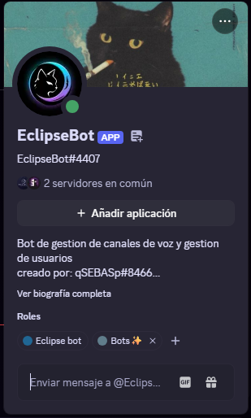

# 🌒 EclipseBot - Discord Automation

<p align="center">
  
  
  
</p>

<p align="center">
  <strong>Un bot de Discord que crea y administra salas de voz temporales de forma automática.</strong>
</p>

---

## 🚀 Descripción del Proyecto

EclipseBot automatiza la gestión de canales de voz en un servidor de Discord. Cuando un usuario entra a un canal "creador", el bot le crea una sala de voz privada y le entrega el control total de ella mediante un panel de botones: puede cambiarle el nombre, alternar entre pública y privada, y ocultarla del resto del servidor. Cuando la sala queda vacía, el bot la elimina para no dejar canales huérfanos.

El objetivo es que cualquier comunidad pueda ofrecer salas de voz personalizadas sin intervención manual de los moderadores.

<p align="center">
  
</p>

## ✨ Características Principales

* 🎙️ **Salas de voz temporales:** al entrar al canal creador se genera automáticamente una sala dedicada para el usuario.
* 🎛️ **Panel de control con botones:** el dueño de la sala puede renombrarla mediante un modal, alternar privacidad y ocultarla del servidor.
* 🔐 **Permisos basados en el dueño:** cada acción valida que el usuario tenga los permisos `manage_channels` o `manage_permissions` antes de ejecutarse.
* 🧹 **Autolimpieza:** la sala se elimina sola en cuanto se queda sin miembros.
* ♻️ **Panel persistente:** el `ControlPanel` se registra con `timeout=None`, así los botones siguen funcionando aunque el bot se reinicie.
* 🌐 **Manejo de eventos en tiempo real:** reacciona a `on_voice_state_update` para crear y destruir canales al instante.

## 🎓 ¿Qué Aprendí y Qué Habilidades Desarrollé?

Este proyecto ha sido fundamental en mi crecimiento como desarrollador autodidacta. No solo construí una herramienta funcional, sino que superé desafíos técnicos que fortalecieron mis conocimientos en:

| Habilidad Técnica Desarrollada | Descripción del Aprendizaje |
| :--- | :--- |
| **🐍 Programación Asíncrona (Python `asyncio`)** | Aprendí a manejar eventos simultáneos sin bloquear la ejecución del bot. Entendí el uso de `async` y `await`, crucial para APIs de red. |
| **🌐 Integración con la API de Discord** | Aprendí a trabajar con `discord.py` 2.x: `Intents`, eventos, `discord.Interaction`, respuestas efímeras y límites de tasa de la API. |
| **🧩 Interfaces con `ui.View` y `ui.Modal`** | Implementé botones persistentes y formularios modales, entendiendo cómo estructurar componentes de UI reutilizables dentro del bot. |
| **🛡️ Gestión de Permisos** | Desarrollé lógica con `PermissionOverwrite` y `permissions_for` para que solo el dueño de la sala pueda modificarla. |
| **🔧 Resolución de Problemas y Depuración** | Enfrenté errores de permisos, canales mal configurados y límites de la API que me ayudaron a mejorar mis habilidades de debugging y a leer documentación técnica. |

## 🛠️ Stack Tecnológico

* **Lenguaje:** Python 3.9+
* **Librería Principal:** `discord.py` 2.x
* **Dependencias adicionales:** ninguna
* **Persistencia:** no utiliza base de datos; el estado vive en los propios canales de Discord

## 📥 Instalación

### Prerrequisitos

* Python 3.9 o superior instalado.
* Un token de bot de Discord ([Crea uno aquí](https://discord.com/developers/applications)).
* Un servidor de Discord donde puedas invitar el bot con los permisos `Gestionar canales` y `Gestionar permisos`.

### Pasos

1.  **Clonar el repositorio:**

    ```bash
    git clone https://github.com/qSEBASp/EclipseBot-Discord.git
    cd EclipseBot-Discord
    ```

2.  **Crear un entorno virtual (opcional pero recomendado) e instalar la dependencia:**

    ```bash
    python -m venv .venv
    .venv\Scripts\activate
    pip install discord.py
    ```

    En Linux/macOS el activador es `source .venv/bin/activate`.

3.  **Configurar el token:**

    * Crea un archivo llamado `config.py` en la raíz del proyecto.
    * Añade tu token de Discord:

      ```python
      TOKEN = "tu_token_aqui"
      ```

    * Este archivo está incluido en `.gitignore`, así que nunca se subirá al repositorio. **No compartas tu token**; si se filtró, restálalo desde el Developer Portal.

4.  **Configurar el canal creador:**

    En `main.py`, reemplaza el valor de `ID_CanalCreador` por el ID del canal de voz que servirá como punto de entrada para crear las salas:

    ```python
    ID_CanalCreador = 148930088  # tu ID real aquí
    ```

5.  **Ejecutar el bot:**

    ```bash
    python main.py
    ```

    Si todo está correcto verás en consola: `✅ EclipseBot conectado como NombreDelBot`.

## 👨‍💻 Autor

Este proyecto fue desarrollado por:

**Sebastian Quiqui Fonque**
* [@qSEBASp en GitHub](https://github.com/qSEBASp)
* [Perfil de LinkedIn](https://www.linkedin.com/in/sebas-quiqui-dev/)
* [sebasfonque@gmail.com](mailto:sebasfonque@gmail.com)

---
*Este proyecto es parte de mi portafolio como desarrollador Junior Frontend (con habilidades de Backend) autodidacta.*
